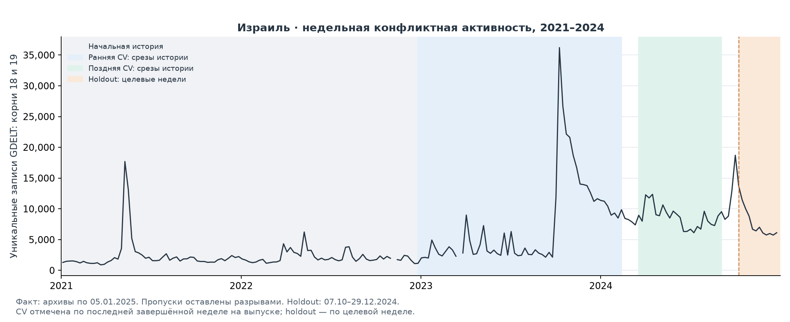
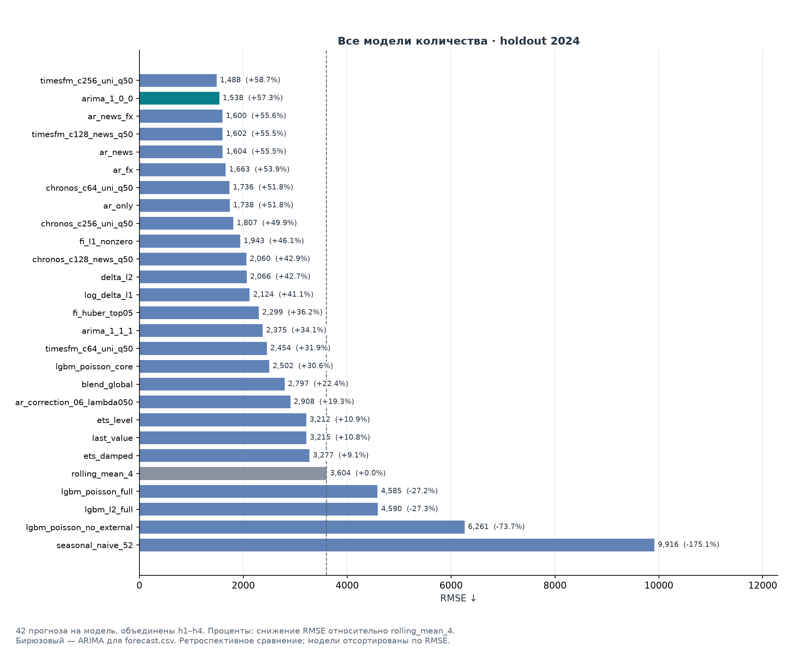
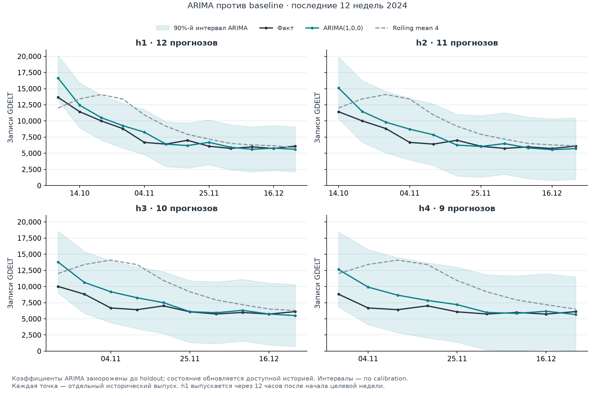
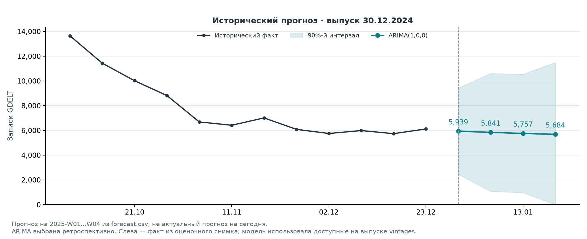

- **Страна:** Израиль — история содержит спокойные периоды, всплески
и смены уровня активности, что позволяет сравнить инерционные, статистические и ML-
модели. Также интересно посмотреть на seasonal naive в Израиле так как боевые
действия возможно повторяются с некоторой сезонностью.
- **Target A:** `y_w = COUNT(DISTINCT GLOBALEVENTID WHERE ActionGeo_CountryCode='IS' AND EventRootCode IN ('18','19') AND Monday(SQLDATE)=w)`. Неделя Пн–Вс; дедупликация между архивами; пропуски — NaN. Прогноз `y_(t+h)`, `h=1…4`, где `t` — последняя завершённая неделя. Факт count_2024 — архивы по 05.01.2025; событийных задач — с дозреванием 7 дней. Правила снимков: [manifest](data/preprocessed/manifest.json).
- **Источники и скачивание (UTC):** [GDELT Events 1.0](https://data.gdeltproject.org/events/) — 15–18.10.2026; [ECB, курсы ILS/USD через EUR](https://www.ecb.europa.eu/stats/eurofxref/eurofxref-hist.zip) — 15.10.2026.
- **Пайплайн:** скачивание архива → фильтр страны/дедупликация → недельные снимки на дату выпуска → лаги, новости, FX, календарь → временная валидация → модели/baseline → метрики и прогнозы с интервалами.
- **Таблица всех моделей vs baseline:** [metrics.csv](outputs/metrics.csv), отдельно по задаче, периоду и горизонту. `RMSE_vs_baseline_pct = 100 × (1 − RMSE_model/RMSE_rolling_mean_4)`; плюс — улучшение. Для событий также precision/recall/F1/AP и обнаружение начал эпизодов.
- **3 вывода:** (1) ARIMA(1,0,0) на count holdout снижает RMSE с 3604 до 1538 (−57,3% к rolling mean 4); (2) раннее обнаружение остаётся слабым: last_value при F1=0,400 на годовом пороге, h2, находит лишь 1/6 начал; (3) улучшать проверку на новых периодах и баланс обнаружений/ложных тревог.
- **Limitations:** задержки и пропуски GDELT пересматривают count; selection bias СМИ/языков/географии; structural breaks снижают переносимость. Count — новостные записи, не число реальных атак; настройки ретроспективны, веса TSFM выпущены после исторического теста.

# Признаки

| Группа | Фичи |
|---|---|
| История target | Последнее завершённое значение; лаги 1, 2, 4, 12, 52. |
| Скользящие статистики | Среднее за 4 недели, стандартное отклонение за 12, максимум за 8, сумма за 12, среднее за 26: локальный фон, разброс и накопленная активность. |
| Тональность и тип событий | AvgTone, среднее и разброс Goldstein по доступным записям недели: тональность сообщений и состав событий. |
| Объём новостей | Все события страны, домены, доля конфликтных записей, изменение объёма, частоты восьми корней CAMEO: интенсивность и структура освещения. |
| Календарь | Номера недели, месяц, наличие и число публичных праздников Израиля в целевой неделе: календарные эффекты. |
| Внешний источник | Лагированные ILS/USD, доходности за 5/20 торговых дней и волатильность за 20 дней ЕЦБ: внешний финансовый сигнал. |
| Динамика | Число недель после крупного скачка, индикатор прошлого скачка, накопленная активность за 12 недель: положение относительно недавних всплесков. |


# Графики









Графики находятся в `outputs/figures/`

# Запуск
```bash
python3 -m venv .venv
source .venv/bin/activate
pip install -r requirements-foundation.txt
python run.py
```

```bash
python run.py --chronos-dir /path/to/chronos-2 --timesfm-dir /path/to/timesfm-3.0
```

Без TSFM: установить `requirements.txt` и запустить `python run.py --without-foundation`. Отдельная задача: `--stage count`, `--stage spike` или `--stage escalation`. Другая папка результатов: `--output /path/to/results`; сохранить прогнозы каждого выпуска: `--save-predictions`.

Отдельная предобработка локальных raw:

```bash
python -m src.preprocess --output data/preprocessed_rebuilt --verify-against data/preprocessed
```

# Структура

```text
run.py                       запуск пайплайна
config.json                  фиксированные настройки моделей
requirements*.txt            зависимости
src/                         данные, признаки, модели и метрики
  preprocess.py              отдельная предобработка локальных raw
  plot_results.py            отдельное построение и проверка графиков
  count.py                   прогноз количества, 2021–2024
  spike.py                   локальный всплеск, 2025
  escalation.py              годовой порог, 2022–2025
  foundation.py              Chronos-2 и TimesFM для трёх задач
  event_features.py           общие признаки и метки событий
  event_models.py             общие ML-модели событий
  event_metrics.py            метрики обнаружения
  остальные модули           модели количества и общие функции
data/
  raw/                       локальные данные GDELT/ECB; исключены из Git
  preprocessed/              готовые снимки данных и manifest.json
outputs/
  metrics.csv                метрики по моделям, периодам и горизонтам
  metrics.json               метрики, интервалы, обнаружение эпизодов и протокол
  forecast.csv               четыре прогноза количества с интервалами
  figures/                   графики, данные holdout и манифест
```

# Использование AI
AI использовался на уровнях L2-L3 viberesearch. Я задавал ему направление исследований, говорил гипотезы, анализировал полученные результаты. А AI выполнял рутинные задачи при учете моего последующего рефакторинга и сверки пайплайна.